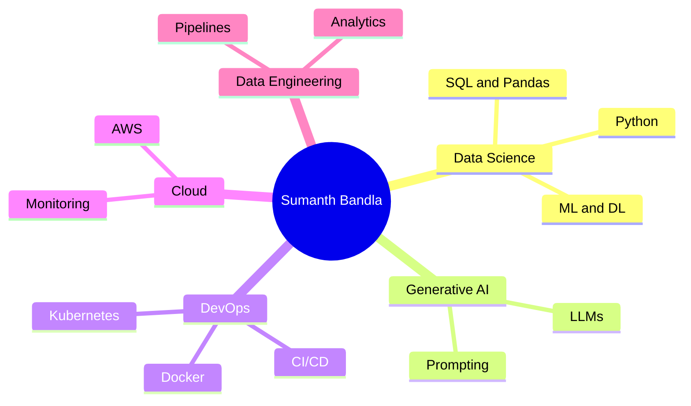
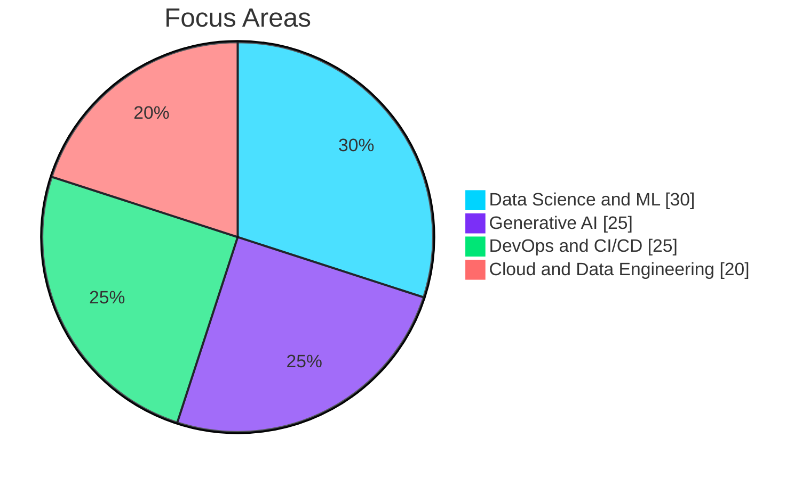
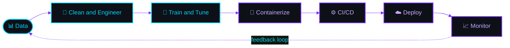
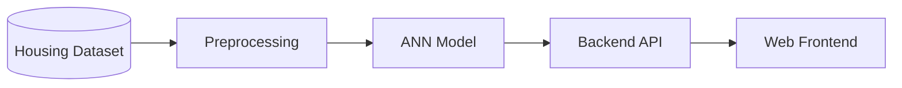
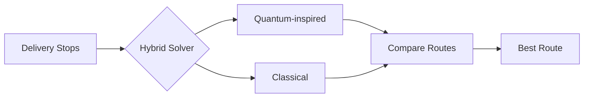
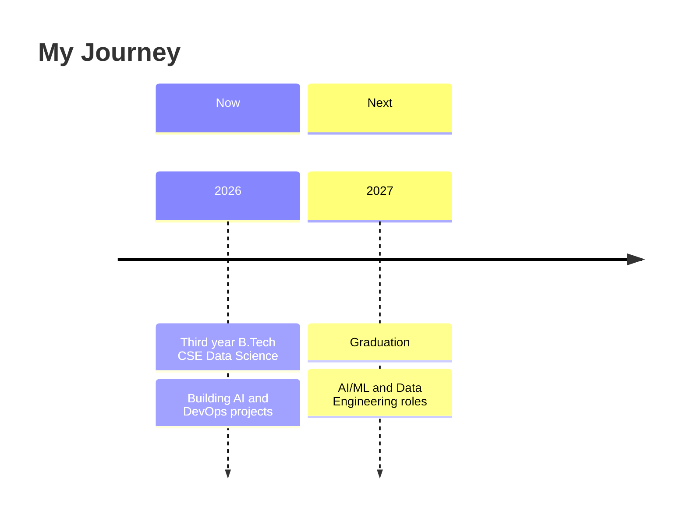
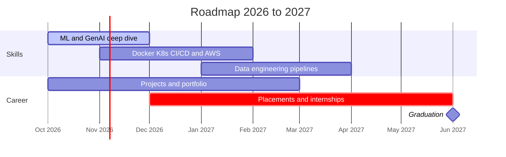

```text
███████╗██╗   ██╗███╗   ███╗ █████╗ ███╗   ██╗████████╗██╗  ██╗
██╔════╝██║   ██║████╗ ████║██╔══██╗████╗  ██║╚══██╔══╝██║  ██║
███████╗██║   ██║██╔████╔██║███████║██╔██╗ ██║   ██║   ███████║
╚════██║██║   ██║██║╚██╔╝██║██╔══██║██║╚██╗██║   ██║   ██╔══██║
███████║╚██████╔╝██║ ╚═╝ ██║██║  ██║██║ ╚████║   ██║   ██║  ██║
╚══════╝ ╚═════╝ ╚═╝     ╚═╝╚═╝  ╚═╝╚═╝  ╚═══╝   ╚═╝   ╚═╝  ╚═╝
██████╗  █████╗ ███╗   ██╗██████╗ ██╗      █████╗
██╔══██╗██╔══██╗████╗  ██║██╔══██╗██║     ██╔══██╗
██████╔╝███████║██╔██╗ ██║██║  ██║██║     ███████║
██╔══██╗██╔══██║██║╚██╗██║██║  ██║██║     ██╔══██║
██████╔╝██║  ██║██║ ╚████║██████╔╝███████╗██║  ██║
╚═════╝ ╚═╝  ╚═╝╚═╝  ╚═══╝╚═════╝ ╚══════╝╚═╝  ╚═╝
```

<div align="center">

### ⚡ Data Scientist &nbsp;•&nbsp; DevOps Engineer &nbsp;•&nbsp; AI Builder ⚡

*"The intersection of Data and DevOps is where I live — automating intelligence at scale."*

<br/>


<br/><br/>

<a href="https://www.linkedin.com/in/sumanth-bandla-7b7189292"></a>
<a href="https://github.com/sumanth-bandla"></a>
<a href="https://www.instagram.com/_mr_.sumanth"></a>

<br/><br/>

<a href="#about-me"><kbd>&nbsp;👨‍💻 About&nbsp;</kbd></a>
<a href="#tech-arsenal"><kbd>&nbsp;🛠️ Stack&nbsp;</kbd></a>
<a href="#skill-matrix"><kbd>&nbsp;📊 Skills&nbsp;</kbd></a>
<a href="#how-i-build"><kbd>&nbsp;⚙️ Workflow&nbsp;</kbd></a>
<a href="#featured-projects"><kbd>&nbsp;🚀 Projects&nbsp;</kbd></a>
<a href="#roadmap"><kbd>&nbsp;🗺️ Roadmap&nbsp;</kbd></a>
<a href="#contact"><kbd>&nbsp;📩 Contact&nbsp;</kbd></a>

</div>

<br/>

> [!IMPORTANT]
> **🚀 Open to internships, collaborations and real-world projects** — especially in **AI / ML**, **Data Engineering** and **DevOps**. Drop a message, I respond fast!

---

<div align="center">

## About Me

</div>

<table align="center" border="0" cellpadding="14" cellspacing="0">
<tr>
<td width="22%" align="center" valign="middle">


<b>Sumanth Bandla</b><br/>
<sub>aka <b>Sunny</b></sub>

</td>
<td width="42%" valign="top">

```yaml
name      : Sumanth Bandla
alias     : Sunny
role      : Data Scientist & DevOps Engineer
status    : Fresher | Ready to Build 🔥
location  : India 🇮🇳
education : B.Tech CSE (Data Science)
graduates : 2027
interests :
  - Generative AI & LLMs
  - MLOps & Cloud Automation
  - CI/CD Pipeline Architecture
  - Data Engineering & Analytics
mindset   : "Ship fast. Learn faster."
```

</td>
<td width="36%" valign="top">

**🚀 Quick Facts**

🔭 Building **AI + DevOps** solutions<br/>
🧠 Obsessed with **LLMs & Gen AI**<br/>
🐳 Containers are my **second language**<br/>
📊 Data nerd who loves clean **pipelines**<br/>
⚡ I automate things **before breakfast**<br/>
📸 Sharing the journey on **social media**<br/>
🌱 Always learning, always **shipping**

</td>
</tr>
</table>

---

<div align="center">

## Tech Arsenal

</div>

<table align="center">
<tr>
<th align="center">🤖 AI & Data</th>
<th align="center">☁️ Cloud & DevOps</th>
<th align="center">🔧 Tools</th>
</tr>
<tr>
<td align="center" valign="top">

<br/>
<br/>
<br/>
<br/>
<br/>
<br/>
<br/>


</td>
<td align="center" valign="top">

<br/>
<br/>
<br/>
<br/>
<br/>


</td>
<td align="center" valign="top">

<br/>
<br/>
<br/>
<br/>


</td>
</tr>
</table>

<div align="center">

<kbd>Python</kbd> <kbd>ML</kbd> <kbd>Deep Learning</kbd> <kbd>LLMs</kbd> <kbd>SQL</kbd> <kbd>Docker</kbd> <kbd>K8s</kbd> <kbd>CI/CD</kbd> <kbd>AWS</kbd> <kbd>Linux</kbd> <kbd>Git</kbd>

</div>

---

<div align="center">

## Skill Matrix

</div>

```text
🧠 DATA & AI
Python            ██████████████████░░  90%
Machine Learning  ████████████████░░░░  80%
Deep Learning     ███████████████░░░░░  75%
SQL               ████████████████░░░░  80%
Generative AI     ██████████████░░░░░░  70%

☁️ DEVOPS & CLOUD
Docker            ███████████████░░░░░  75%
CI/CD             ███████████████░░░░░  75%
Linux & Bash      ████████████████░░░░  80%
AWS               █████████████░░░░░░░  65%
Kubernetes        ████████████░░░░░░░░  60%
```

<div align="center">

### Knowledge Map

</div>



<div align="center">

### Focus Split

</div>



---

<div align="center">

## How I Build

*From raw data to a monitored production system.*

</div>



---

<div align="center">

## Featured Projects

</div>

<table align="center">
<tr>
<td width="50%" valign="top">

### 🏠 India House Price Prediction
**Full-stack ANN project**

Deep-learning model that predicts Indian house prices, wrapped in a complete full-stack application.


[🔗 View on GitHub](https://github.com/sumanth-bandla?tab=repositories)

</td>
<td width="50%" valign="top">

### ⚛️ Quantum Route Optimizer
**Hybrid optimization route planner**

Delivery route planner combining quantum-inspired and classical algorithms for smarter, shorter routes.


[🔗 View on GitHub](https://github.com/sumanth-bandla?tab=repositories)

</td>
</tr>
</table>

<details>
<summary><b>🔍 Architecture: House Price Prediction</b></summary>



</details>

<details>
<summary><b>🔍 Architecture: Quantum Route Optimizer</b></summary>



</details>

---

<div align="center">

## Roadmap

</div>





<div align="center">

### Current Mission

</div>

<table align="center">
<tr>
<td align="center" width="25%">🔭<br/><b>Building</b><br/><sub>AI + DevOps projects<br/>end-to-end pipelines</sub></td>
<td align="center" width="25%">📚<br/><b>Learning</b><br/><sub>LLMs, MLOps,<br/>Data Engineering</sub></td>
<td align="center" width="25%">🎯<br/><b>Targeting</b><br/><sub>AI/ML and Data Engineering<br/>roles and internships</sub></td>
<td align="center" width="25%">🤝<br/><b>Open To</b><br/><sub>Collabs, internships,<br/>real-world projects</sub></td>
</tr>
</table>

<details>
<summary><b>💡 Fun fact (click to expand)</b></summary>
<br/>

I automate things before breakfast — and I believe the best pipeline is the one you never have to touch twice. ☕🤖

</details>

---

<div align="center">

## Contact

### 💬 Let's Build Something Amazing Together

🚀 **Open to internships, collabs, and real-world projects**<br/>
📩 **Drop a message — I respond fast!**

<br/>

<a href="https://www.linkedin.com/in/sumanth-bandla-7b7189292"></a>
<a href="https://github.com/sumanth-bandla"></a>
<a href="https://www.instagram.com/_mr_.sumanth"></a>

<br/><br/>

</div>

```text
┌──────────────────────────────────────────────────────────┐
│  $ git commit -m "Learning → Building → Shipping"        │
│  $ docker build -t my-ai-app . && docker run my-ai-app   │
│  $ python train.py --epochs 100 --gpu                    │
│                                                          │
│  >> Thanks for visiting. Ship fast. Learn faster. ⚡     │
└──────────────────────────────────────────────────────────┘
```

<!--
═══════════════ OPTIONAL EXTRAS (OFF BY DEFAULT) ═══════════════
These use free public servers that sometimes go down and show
"Error Fetching Resource". To try them, delete the comment markers
at the start and end of this block, then paste it above the footer.

<div align="center">


</div>
-->
